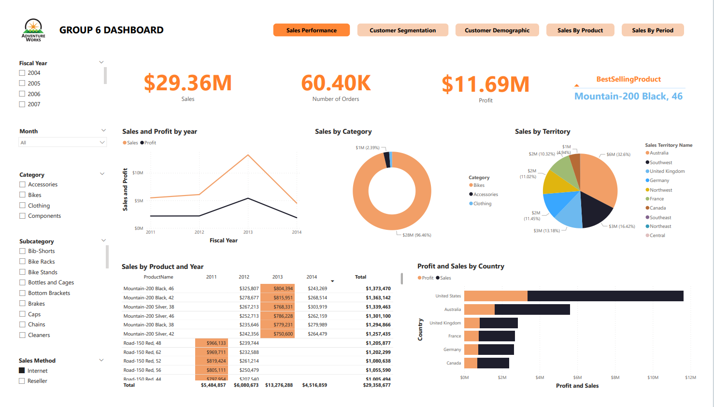
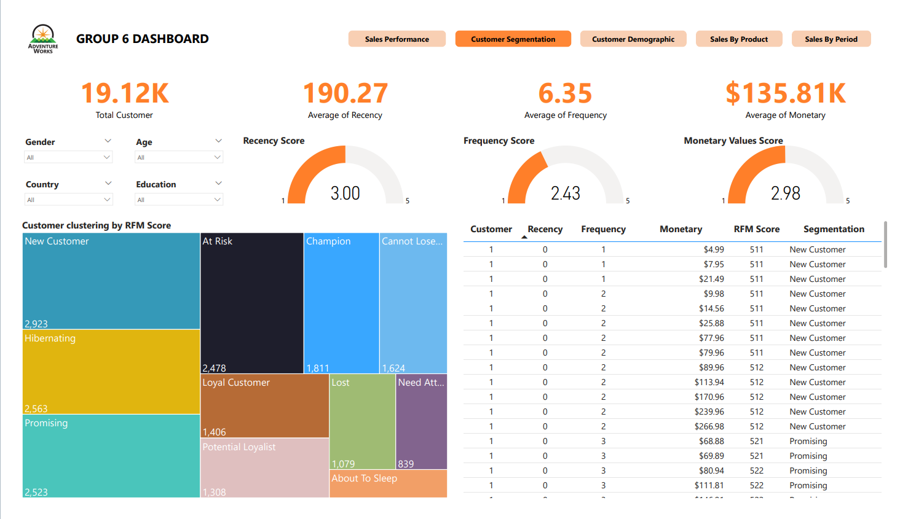
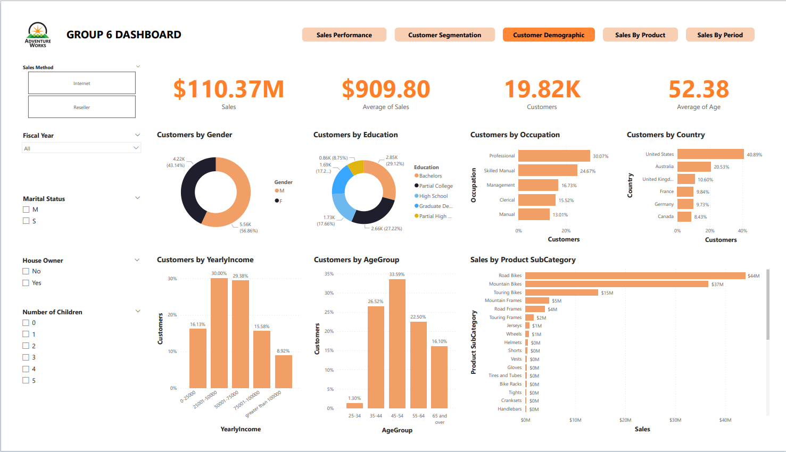
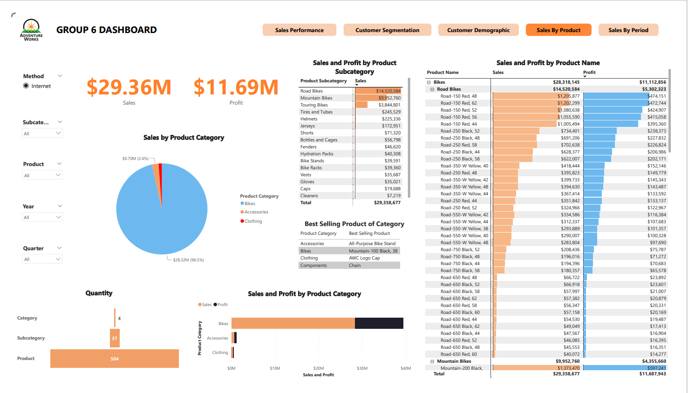
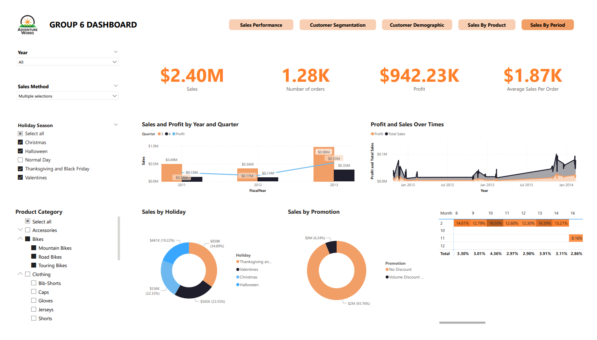

# Business Intelligence Solution for Sales Module of Adventure Works Cycles
Project about Business Intelligence at UEL

## Table of content
- [Objective](#objective)
- [Key Feature](#key-feature)
- [Technologies Used](#technologies-used)
- [Installation and Setup](#installation-and-setup)
- [Usage](#usage)
- [Outcomes](#outcomes)
- [License](#license)
  
## Objective
Develop a comprehensive Business Intelligence (BI) solution to enhance sales analysis and decision-making for Adventure Works Cycles.

## Key Features
- **Data Warehouse**: Consolidates and organizes sales data for better accessibility and analysis.
- **Data Visualization**: Utilizes Power BI to create interactive dashboards and reports.
- **Sales Analysis**: Provides insights into sales trends, performance metrics, and customer segmentation.

## Technologies Used
- **SQL**: For data extraction, transformation, and loading (ETL) processes.
- **Power BI**: For data visualization and interactive report generation.
- **SSIS, SSAS**: For structured and efficient data storage and created DW.

## Installation and Setup
1. **Clone the Repository**:
   ```bash
   git clone https://github.com/duan-n2d/analytics-case-studies.git
   ```

2. Set Up Database:
- Import the provided SQL scripts to set up the Adventure Works Cycles database.
- Ensure your SQL Server is properly configured and running.

3. Load Data into Data Warehouse:
- Execute the ETL scripts to load sales data into the data warehouse.
- Verify that the data is correctly imported and structured.

4. Configure Power BI Reports:
- Open the Power BI Desktop.
- Load the Power BI project file (.pbix) provided in the repository.
- Connect the Power BI reports to your SQL Server database.

## Usage
- Open the Power BI Desktop and navigate to the loaded project file.
- Refresh the data to ensure the latest information is displayed.
- Explore the interactive dashboards and reports to gain insights into sales performance and customer behavior.

## Outcomes
- Actionable Insights: Delivered through interactive dashboards, improving strategic planning and operational efficiency.
- Improved Decision-Making: Enabled by detailed sales analysis and customer segmentation.







## Resource
Dataset [Advanture Work](https://learn.microsoft.com/en-us/sql/samples/adventureworks-install-configure?view=sql-server-ver16&tabs=ssms)

## License
This project is licensed under the MIT License - see the [LICENSE](../../LICENSE) file for details.
